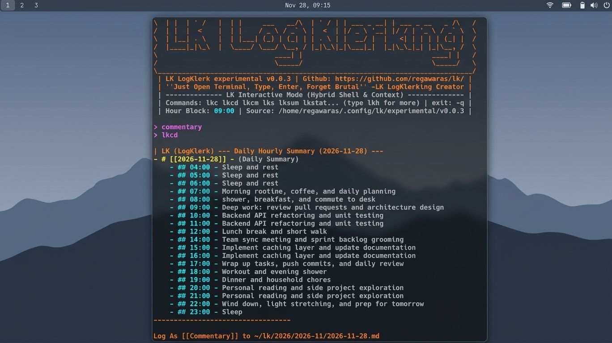
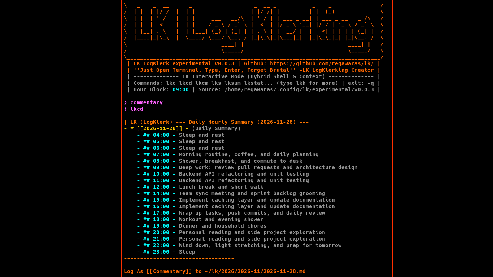

# LogKlerk (LK)

> *"Just Open Terminal, Type, Enter, Forget Brutal"*

**LogKlerk** is a lightning-fast, highly structured terminal journaling system. It acts as your chronological brain dump: every line you type is timestamped and filed into a plain Markdown vault, organized by year, month and day. No database, no GUI, no lock-in.

## 📸 Screenshots & Examples
### Full Desktop Setup View


### Minimalistic Setup View


### Example Comparison
| Minimalistic Setup View | Full Desktop Setup View |
| :---: | :---: |
|  |  |

## Multiple Programming Language
LogKlerk comes in three flavors:

| | **Rust version** (main) | **Shell version** (alternative) | **Assembly version** (experimental) |
|---|---|---|---|
| Status | `experimental` · `v0.0.3` | Original implementation | `experimental` · `v0.0.3` · CSV format |
| Form | Single binary, `std` only, no crates | POSIX `sh` functions, sourced into your shell | Standalone x86-64 Linux binary, no libc, pure syscalls |
| Best for | Speed, interactive mode, analytics, everyday use | Minimal systems, strict POSIX shells, zero compilation | Ultra-lightweight binary, zero dependencies, CSV logging |
| Jump to | [Rust version](#-rust-version-main) | [Shell version](#-shell-version-alternative) | [Assembly version](#-assembly-version-v003) |

---

## ✨ Key Features

- **Chronological logging**: everything is stamped `HH:MM:SS` and inserted into the right hour block automatically.
- **Hybrid interactive mode**: a mini shell + journal. Type a note and it is logged; type a real command (`ls`, `git status`, `cd ...`) and it runs *and* is logged.
- **Everything is a log**: every `lk` command (`lkc`, `lkcd`, `lksum`, ...) and every input typed in interactive mode is recorded with a timestamp.
- **Dynamic taxonomy**: create your own quick-logging tags (`todo`, `ideas`, ...) on the fly.
- **Summaries & plans**: add hourly, daily, monthly and yearly summaries that build a table of contents over time.
- **Search & analytics** *(Rust)*: ranking, stats, charts, word frequency, lexical diversity, snapshots and more.
- **Plain vault**: Markdown (`YYYY/YYYY-MM/YYYY-MM-DD.md`) in Rust/Shell, or RFC 4180 CSV (`YYYYMMDD.csv`, one file per local day by default) in Assembly. Open it with any editor.
- **Concurrency safe**: simultaneous terminals don't corrupt your logs.

---

# 🦀 Rust Version (Main)

A port of the original shell modules into one binary with **no external dependencies** (standard library only). Targets Linux, macOS and BSD (it uses `localtime_r` from libc; Windows is not supported).

## 🚀 Installation

**1. Build**

```bash
git clone https://github.com/regawaras/lk.git
cd lk/rust
cargo build --release
```

The Rust source lives in `lk/rust/`:

```text
lk/rust/
├── Cargo.toml
└── src/
    ├── main.rs            # LogKlerk core (v0.0.3)
    └── default_tags.rs    # built-in tags, loaded via `mod default_tags;`
```

The binary is built as `target/release/lk` (make sure `name = "lk"` is set in `Cargo.toml`).

**2. Put the binary on your `PATH`**

```bash
install -m 755 target/release/lk ~/.local/bin/lk
```

**3. Create the command shortcuts** (optional, recommended)

```bash
lk -install ~/.local/bin
```

This creates symlinks (`lkc`, `lkcd`, `lks`, `lksum`, `todo`, `ideas`, ...) that all point to the one binary, so you can type `lkc` instead of `lk lkc`. Make sure the directory is on your `PATH`.

**4. Enable `cd` persistence** (optional, recommended)

A program can't change its parent shell's directory, so LogKlerk ships a tiny wrapper. Add this to `~/.bashrc` or `~/.zshrc`:

```bash
eval "$(lk --init)"
```

For fish:

```fish
lk --init fish | source
```

With the wrapper installed, if you `cd` somewhere inside interactive mode, your shell lands in that same directory when you exit. Without it, LogKlerk prints a short hint on exit if the directory changed.

## ⚙️ Configuration

On first run, LogKlerk creates its config at:

```text
~/.config/lk/experimental/v0.0.3/lk.conf
```

> Config folders are versioned. When upgrading, copy your settings from the previous version's folder.

Default `lk.conf`:

```bash
LK_DIR="$HOME/lk"
LK_TAIL_LINES="10"
LK_DEFAULT_FORMAT=".md"
LK_COLOR_HOURLY_SUMMARY="yellow"
```

| Key | Meaning | Default |
| --- | --- | --- |
| `LK_DIR` | Where your vault lives (can also be set as an environment variable) | `~/lk` |
| `LK_TAIL_LINES` | Lines of context shown after logging | `10` |
| `LK_COMMAND_TAIL_LINES` | Same, after a shell command in interactive mode | `3` |
| `LKSET_TAIL_LINES` | Context lines shown after `lkset` / `lkconf` | `5` |
| `LK_DEFAULT_FORMAT` | Log file extension | `.md` |
| `LK_SNAP_DIR` | Where `lksnap` stores snapshots | `~/snapshots/lk` |
| `LK_COLOR_HOURLY_SUMMARY` | Color of the `(Hourly Summary)` placeholder | `yellow` |

Change any value from inside LogKlerk:

```bash
lkconf LK_TAIL_LINES="5"
lkconf LK_COLOR_HOURLY_SUMMARY="#FF8800"
```

**Color formats** for `LK_COLOR_HOURLY_SUMMARY`: a name (`yellow`, `amber`, `gold`, `orange`, `red`, `green`, `lime`, `cyan`, `blue`, `purple`, `magenta`, `pink`, `white`, `grey`), hex (`#RRGGBB`), decimal `R,G,B` (e.g. `255,221,0`), or a 0-255 terminal color index.

Run `lk -c` to view your current configuration. Edit the banner with `lkv banner`.

## 📖 Core Usage

LogKlerk's core loop is **Write (`lk`)**, **Read (`lkc`)** and **Search (`lks`)**.

### 1. Writing

```bash
# Quick one-liner
lk "Successfully migrated my server to NixOS"

# Log with a version tag
lk -v "Tested the new release"

# Log with a taxonomy alias
lk @todo "Fix the Nginx reverse proxy routing"
todo "Fix the Nginx reverse proxy routing"      # same thing, via symlink

# Open interactive mode
lk
```

### 2. Interactive Mode

Run `lk` (or `lki`) with no arguments:

```text
Log to ~/lk/2026/2026-04/2026-04-12.md
>> 
```

| You type | What happens |
| --- | --- |
| Plain text | Logged with a timestamp |
| `todo` | Switches the active category to `todo` (following lines are logged as todos) |
| `todo Fix nginx` | Logs that single line as a todo |
| `ls`, `git status`, `cd ~/proj` | Runs in your shell **and** is logged |
| `lkc`, `lkcd`, `lksum ...` | Runs the LK module **and** is logged |
| `clear` | Redraws the header (logged) |
| `-q` / `exit` / `quit` | Leaves interactive mode (logged) |

Every non-empty input is written to the log, including exits and category switches. Only a bare Enter is ignored.

### 3. Reading

```bash
lkc                 # Everything logged today
lkc 20260412        # A specific date (also 2026-04-12)
lkc 14              # Today's 14:00 block
lkc 08-12           # Today between 08:00 and 12:00
lkc -m              # Daily summaries for the current month
lkc -y              # Daily summaries for the current year
lkc -a              # Every daily summary, ever
lkch                # Current hour block
lkcd [YYYYMMDD]     # Daily + hourly summary recap
lkcm [YYYYMM]       # All daily summaries in a month
lkcy [YYYY]         # Historical timeline (min|mid|max|fit|full)
```

### 4. Searching

```bash
lks "Nginx"            # Search the whole vault
lks -t "Nginx"         # Today only
lks -08 "server"       # Any day, but only entries from the 08:xx hour
lks 2026-04 "Linux"    # A specific month
```

### 5. Summaries & Plans

```bash
lksum 2026 "Year of the terminal"           # Yearly
lksum 202604 "Backend month"                # Monthly
lksum 20260422 "Focused on optimization"    # Daily
lksum 14 "Deep work: database refactor"     # Hour 14 today
lksum 08-10 "Morning block"                 # Batch of hours

lkplan 20260423 "Ship v0.0.3"               # Same targets, tagged ![PLAN]!
```

## 🏷️ Dynamic Tags (Taxonomy)

```bash
lkset wbl="[[Web]]"            # New alias: wbl -> [[Web]] >>
lkfiles ideas="[[Ideas]]"      # Exclusive alias: logs into its own folder
lknote groceries="groceries.md"  # Alias pointing to a static note
lk tags                        # List every registered alias
```

Use them directly or from interactive mode:

```bash
wbl "Read the htmx docs"
# - 15:30:00 - [[Web]] >> Read the htmx docs
```

## 🧰 Full Command Reference

Type `lkh` (or `lk -h`) for the built-in manual. Overview:

| Group | Commands |
| --- | --- |
| **Core** | `lk`, `lki`, `lk -v`, `lk @alias`, `lk -e`, `lk -pwd`, `lk -c`, `lk --init` |
| **Taxonomy** | `lkset`, `lkfiles`, `lknote`, `lk tags`, `lk -install` |
| **Summaries** | `lksum`, `lkplan` |
| **Reader** | `lkc`, `lkcd`, `lkch`, `lkcm`, `lkcy` |
| **Search & analytics** | `lks`, `lksort`, `lkstat`, `lkrank`, `lkchart`, `lkword`, `lkwords`, `lkdiversity`, `lkyaml`, `lkweight`, `lkdistraction`, `lkvoid`, `lkhour`, `lkminute`, `lksecond` |
| **Maintenance** | `lkv`, `lkconf`, `lkspace`, `lksnap` |

## 🏗️ Data Structure

```text
~/lk/
└── 2026/
    └── 2026-04/
        └── 2026-04-12.md
```

Example daily file:

```markdown
- # [[2026-04-12]] - Focused on backend optimization
    created: [[2026-04-12]] - 08:05:12
- ## 08:00 - (Hourly Summary)
  - 08:15:30 - [[TODO]] >> Fix the Nginx reverse proxy routing
  - 08:40:02 - [[zsh]] >> git status
  - 08:41:10 - [[lk]] >> lkc
- ## 15:00 - (Hourly Summary)
  - 15:30:00 - [[Writing on Vim]] >> Drafting the README.md
```

Entries are inserted in chronological order into their hour block. Commands run inside interactive mode are tagged with your shell (e.g. `[[zsh]] >>`), and LK's own commands with `[[lk]] >>`.

---

# 🐚 Shell Version (Alternative)

The original **100% POSIX-compliant** implementation, written in pure `sh`. Choose it when you can't (or don't want to) compile anything, or you're on a minimal system such as Alpine, NixOS or a strict `dash` environment.

## Features

- **POSIX core**: runs on `dash`, `bash`, `zsh`, Alpine Linux, NixOS and macOS.
- **Hybrid interactive mode**: detects `bash` to enable GNU Readline (arrow-key navigation) and falls back to plain `read` on strict POSIX shells.
- **XDG Base Directory standard**: data in `~/.local/share/logklerk`, config in `~/.config/logklerk`.
- **Concurrency safe**: file-descriptor locking (`flock -x 9`).
- **Location manager**: move your data directory to a synced folder (Dropbox, Nextcloud, ...) with one command.

## Installation

LogKlerk (shell) is a collection of functions and aliases, so it must be **sourced** into your shell, not executed.

**1. Download the script**

```bash
mkdir -p ~/.config/logklerk
curl -o ~/.config/logklerk/lk.sh https://raw.githubusercontent.com/regawaras/lk/main/lk.sh
```

**2. Source it from your shell profile**

Bash / Zsh (`~/.bashrc` or `~/.zshrc`):

```bash
echo '. "$HOME/.config/logklerk/lk.sh"' >> ~/.bashrc
source ~/.bashrc
```

Strict POSIX / Dash (`~/.profile` and `~/.shinit`):

```bash
echo 'export ENV="$HOME/.shinit"' >> ~/.profile
echo '. "$HOME/.config/logklerk/lk.sh"' >> ~/.shinit
```

## Usage

> The shell version uses its own flag-style commands (`lk -set`, `lk -add`), which differ from the Rust version's `lksum` / `lkset`. Don't mix the two command sets.

**Writing**

```bash
lk "Successfully migrated my server to NixOS"
lk                                   # interactive mode

todo "Fix the Nginx reverse proxy routing"
ideas "Build an automated backup script using rsync"
sog "How to configure dash as default shell"
problems "Kernel panic after updating NVIDIA drivers"
```

**Reading**

```bash
lkc                 # All notes for today
lkcs                # Today's main summaries (daily & hourly)
lkc 2026-04-12      # A specific date
lkc -m              # Daily summaries for the current month
lkc 08-12           # Today between 08:00 and 12:00
```

**Searching**

```bash
lks "Nginx"            # Global search
lks -t "Nginx"         # Today only
lks -08 "server"       # Only at 08:xx
lks 2026-04 "Linux"    # A specific month
```

**Custom tags** (stored in `~/.config/logklerk/lk_tags`)

```bash
lk -add wrv "Writing on Vim"
wrv "Drafting the README.md documentation"
# - 15:30:00 - [[Writing on Vim]] >> Drafting the README.md documentation
```

**Location manager**

```bash
lk -set -dir ~/Dropbox/LogKlerk     # custom path
lk -set -dir -default               # XDG default (~/.local/share/logklerk)
lk -set -dir -home                  # ~/LogKlerk
```

**Summaries**

```bash
lk -set -today "Focused on backend optimization"
lk -set 2026-04-10 "Vacation day"
lk -set 08-10 "Deep Work: Database Refactoring"
```

**Manual editing** (uses `$EDITOR`, defaults to `vim`)

```bash
lkv                 # today's file
lkv 2026-04-10      # a specific date
```

**Data layout**

```text
~/.local/share/logklerk/2026/2026-04/2026-04-12.md
```

```markdown
- [[2026-04-12]] - Focused on backend optimization
    created: [[2026-04-12]] - 10:00:00
- 08:00 - Deep Work: Database Refactoring
- 15:00 - Open Source Contributions

- 08:00 - (Hourly Summary)
  - 08:15:30 - [[TODO]] >> Fix the Nginx reverse proxy routing
- 15:00 - (Hourly Summary)
  - 15:30:00 - [[Writing on Vim]] >> Drafting the README.md
```

---

# ⚙️ Assembly Version (v0.0.3)

A standalone **x86-64 Linux** implementation written in GNU Assembler (`as`, Intel syntax) with **no `libc`** and pure Linux system calls (`clock_gettime`, `open`, `read`, `write`, `mkdir`, `ioctl`, `fork`, `execve`, `wait4`, `pipe2`, `exit`, ...). Instead of Markdown files, it writes RFC 4180 CSV entries (`date,tags,context,activity`).

## Features

- **Zero dependencies**: no `libc`, no runtime, fixed `.bss` buffers with explicit bounds checks, and no recursion or stack arrays.
- **Modular source**: the core lives in `src/main.asm`; the `lkc` log reader is its own module, `src/modules/lkc.asm`, pulled in with `.include`.
- **ISO 8601 local timestamps**: `YYYYMMDDThhmmss`, no milliseconds. The time zone comes from `$TZ` or `/etc/localtime` (the TZif file is parsed natively, DST included) and falls back to UTC if no zone file is readable.
- **Quoted string fields**: `context` and `activity` are always written as quoted CSV strings (`"..."`), with internal `"` doubled and CR/LF replaced by spaces, so every entry stays on one line.
- **Hybrid interactive mode**: the first word of a line is *optional* as a command. If it is a Linux command, a builtin, or an alias/function from `~/.bashrc` or `~/.profile`, the line runs **and** is logged; otherwise it is only logged as a plain note, with no "command not found" noise. This works in both basic mode and taxonomy (context) mode.
- **Colored output** (on a TTY): orange date, yellow tags, purple context, light-grey activity. Respects `NO_COLOR`.
- **Race-free & concurrency safe**: creates log files with `O_CREAT|O_EXCL` (mode `0600`), rejects symlinks with `O_NOFOLLOW`, and writes each complete row with a single `O_APPEND` write.
- **Configurable taxonomy**: up to 32 `[taxonomy]` entries in `lk.conf`, editable from inside LogKlerk with `lkset`.

## 🚀 Build & Installation

**1. Assemble and link**

From the directory that contains `src/`:

```bash
as --64 -g -I src src/main.asm -o lk.o
ld -z noexecstack -z relro -z now -o lk lk.o
```

The source layout:

```text
src/
├── main.asm            # core: config, logging, shell, lkset, interactive loop
└── modules/
    └── lkc.asm         # lkc log reader (included by main.asm)
```

> The `-I src` flag is required so `main.asm` can find `modules/lkc.asm`.

**2. Put the binary on your `PATH`**

```bash
install -m 755 lk ~/.local/bin/lk
```

**3. Runtime requirements**

`bash` at `/bin/bash` is used to resolve commands and aliases. If it is missing, LogKlerk falls back to `/bin/sh` (no alias support).

## ⚙️ Configuration

Configuration is read from `~/.config/logklerk/lk.conf` (falling back to built-in defaults if missing or empty). Defaults:

```ini
[settings]
LK_DIR="$HOME/.local/share/logklerk/"
LK_NAME_FORMAT="YYYYMMDD"
LK_DEFAULT_FORMAT=".csv"
LK_TAIL_LINES="3"
LKSET_TAIL_LINES="3"
[taxonomy]
gg="Googling"
gam="Google AI Mode"
claude="Claude"
soy="Search on Youtube"
diary="Diary"
com="Commentary"
```

| Key | Meaning | Default |
| --- | --- | --- |
| `LK_DIR` | Log directory (`$HOME` or a leading `~` is expanded; a trailing `/` is added; created with `mkdir -p`, mode `0700`) | `$HOME/.local/share/logklerk/` |
| `LK_NAME_FORMAT` | Log file name pattern, computed for every entry (see below) | `YYYYMMDD` |
| `LK_DEFAULT_FORMAT` | Log file extension (must start with `.`) | `.csv` |
| `LK_TAIL_LINES` | Lines shown after logging (0-16) | `3` |
| `LKSET_TAIL_LINES` | Taxonomy lines shown after `lkset` (0-32) | `3` |
| `LK_COLOR_DATE` | Color of the date column | `orange` |
| `LK_COLOR_TAGS` | Color of the tags column | `yellow` |
| `LK_COLOR_CONTEXT` | Color of the context column | `purple` |
| `LK_COLOR_ACTIVITY` | Color of the activity column | `grey` |

**Colors:** `grey`, `red`, `green`, `yellow`, `blue`, `magenta`, `cyan`, `white`, `orange`, `purple`.

**`LK_NAME_FORMAT` tokens:** `YYYY`, `MM`, `DD`, `hh` (or `HH`), `mm`, `ss`. Anything else is literal and `/` becomes `_`. The default `YYYYMMDD` gives one file per local day; a finer pattern such as `YYYYMMDDThhmmss` would start a new file for every entry. Because the name is recomputed per entry, a session that crosses local midnight rolls over to the next day's file automatically.

**Time zone:** taken from `$TZ` (for example `TZ=Asia/Jakarta`) or `/etc/localtime`. The old `TZ_OFFSET` setting no longer exists.

## 📖 Usage

```bash
lk -h | --help                    # Show usage help
lk                                # Interactive mode (exit, quit, or Ctrl-D to quit; shows `lk> ` on a TTY)
lk <key> <text...>                # Log with context from [taxonomy]
lk lkc [all|filter] [asc|desc]    # Read logs (default: today, local time)
lk lkset taxonomy key="Value"     # Add or change a taxonomy entry in lk.conf
lk <command...>                   # Run a Linux command and log it as "bash"
```

### Interactive Mode

| You type | What happens | Logged as |
| --- | --- | --- |
| Plain text (`buy milk tomorrow`) | Logged only, nothing runs | `none,"","buy milk tomorrow"` |
| A command or alias (`ls -la`, `hello`) | Runs in `bash` **and** is logged | `none,"bash","ls -la"` |
| `cd ~/proj` | Built-in `cd`, changes the working directory | `none,"bash","cd ~/proj"` |
| `gg` (a taxonomy key alone) | Enters that context; the prompt becomes `lk [[Googling]] >` | `lk,"lktags","gg"` |
| `gg what is linux` | Logs one line under that key, without switching mode | `gg,"Googling","what is linux"` |
| Text while in a taxonomy mode | Logged under the active key; a real command runs too | `gg,"Googling","..."` |
| `lk` while in a taxonomy mode | Leaves the mode | `lk,"lktags","lk"` |
| `lkc ...`, `lkset taxonomy ...` | Runs the built-in reader / taxonomy editor | `lk,"commands","lkc ..."` |
| `exit` / `quit` / Ctrl-D | Leaves interactive mode | `lk,"commands","exit"` |

Reserved words that cannot be used as taxonomy keys: `lk`, `lkc`, `lkset`, `cd`, `exit`, `quit`.

> **Heads up:** in a taxonomy mode a line is run whenever its first word is a command. A note such as `cat videos are funny` would execute `cat`. Start the line with a word that is not a command, or leave the mode with `lk`.

> **Aliases** from `~/.bashrc` are loaded through `bash -i`, which is only used when stdin is a TTY. In piped (non-TTY) use, commands and `~/.profile` still work but `~/.bashrc` aliases do not. One-shot CLI mode (`lk ls -la`) passes the arguments straight to `sh` and does not expand aliases.

### Reading with `lkc`

```bash
lkc                      # Today's rows (local time)
lkc all                  # Every row of every file
lkc 2026                 # A year             (YYYY)
lkc 202611               # A month            (YYYYMM)
lkc 20261128             # A day              (YYYYMMDD)
lkc 20261128T14          # An hour            (up to YYYYMMDDThhmmss)
lkc 20261101-20261128    # An inclusive range (from-to)
lkc 20261128 desc        # Newest file first (default: asc)
```

`all` cannot be combined with a date filter. Filters are prefix matches against the timestamp, so old rows from earlier versions (which had a `.SSS` suffix) are still matched.

### Data Layout & Format

Log files are named from `LK_NAME_FORMAT` + `LK_DEFAULT_FORMAT` inside `LK_DIR`:

```text
~/.local/share/logklerk/
└── 20261128.csv
```

Line format: `YYYYMMDDThhmmss,tags,"context","activity"`

```csv
date,tags,context,activity
20261128T162600,gg,"Googling","x86-64 linux syscall clock_gettime"
20261128T162615,none,"bash","ls -la"
20261128T162630,none,"","a plain note, no command"
20261128T162700,lk,"lktags","gg"
20261128T162712,gg,"Googling","tzif file format"
```

| Column | Meaning |
| --- | --- |
| `date` | Local time, ISO 8601 basic format `YYYYMMDDThhmmss` |
| `tags` | The taxonomy key (`gg`, `diary`, ...), or `none` (shell line / plain note), or `lk` (LogKlerk's own commands and mode switches) |
| `context` | Quoted string: the taxonomy context name, `bash` for commands, `lktags` / `commands` for `lk` entries, empty for plain notes |
| `activity` | Quoted string: exactly what you typed |

### Upgrading from v0.0.1 / v0.0.2

- Rename `DIR` to `LK_DIR` in `lk.conf` if you still have the old key, and remove `TZ_OFFSET` (the local zone is used now).
- The CSV header is `date,tags,context,activity`; rows written by older versions stay readable and still match `lkc` filters.
- `lkc` without arguments now shows only today's rows; use `lkc all` for the old behaviour.

---

# 🔄 Migrating Between Versions

The Rust and Shell versions both write plain Markdown files in the same `YYYY/YYYY-MM/YYYY-MM-DD.md` layout, so the Rust version is designed to read an existing shell vault.

1. **Back up first**: copy your vault directory somewhere safe.
2. Point the Rust version at your existing data in `lk.conf`:

   ```bash
   lkconf LK_DIR="$HOME/.local/share/logklerk"
   ```

3. Open a few days with `lkc <date>` and confirm they look right before relying on it.

Config files, tags and commands are **not** shared across versions: re-create your aliases with `lkset` / `lkfiles` in the Rust version, or in `lk.conf` for the Assembly version.

---

## 📄 License

This project is licensed under the MIT License. Feel free to fork, modify and improve!
